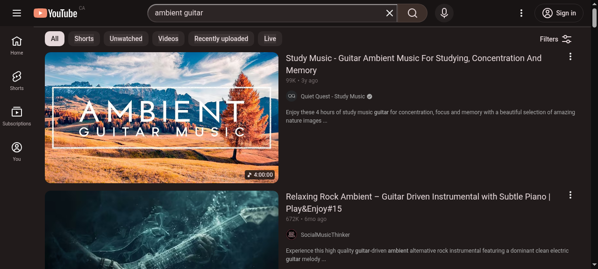
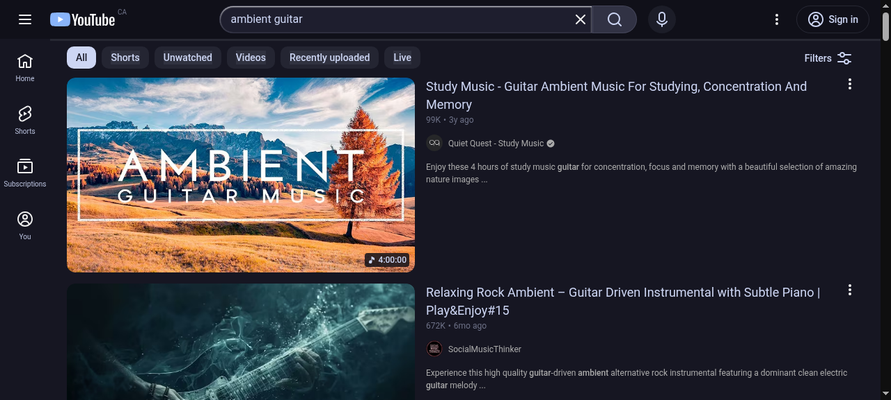

# youtube-themes

YouTube, repainted to match your omarchy theme.

One CSS file per omarchy theme — Ristretto, Catppuccin, Gruvbox, Nord, Tokyo Night,
Kanagawa, Everforest… 17 of the dark ones are pre-built in [`themes/`](themes/), and
`gen-theme.py` builds the rest from your installed palette (local overrides included).

| ristretto | catppuccin |
|---|---|
|  |  |

## Use a theme

1. Turn on YouTube's dark appearance (avatar → Appearance → Dark), or set Enhancer
   for YouTube's theme to **YouTube Dark**. The CSS can't switch dark mode on by
   itself — it repaints what is already dark.
2. Open `themes/<your-theme>.css` and copy the whole file.
3. Paste it into a custom-CSS box:
   - **Enhancer for YouTube** → Theme → tick **Custom theme** → paste → Save
   - **Stylus** → new style for `youtube.com` → paste
   - any other extension with a custom CSS field
4. Reload the YouTube tab.

That's the whole install — no account, nothing installed beyond the injector.

## Build one for your theme

```bash
./gen-theme.py                 # list of available omarchy themes
./gen-theme.py gruvbox         # -> themes/gruvbox.css
./gen-theme.py --all           # every dark omarchy theme
./gen-theme.py ristretto --stdout | wl-copy
```

It reads `~/.config/omarchy/themes/<name>/colors.toml` first, then
`/usr/share/omarchy/themes/<name>/colors.toml`, so a theme you have retuned locally
generates correctly. Light themes (`catppuccin-latte`, `flexoki-light`, `lupine`,
`rose-pine`, `white`) are skipped by default: the stylesheet forces dark surfaces, so
a light palette would come out text-on-same-text. `--force` builds them anyway.

Requires Python 3.11+ (nothing else).

## How it maps

| YouTube surface | palette key |
|---|---|
| page canvas | `dark_background` |
| panels, search, menus | `background` |
| masthead, scrollbar track | `darker_background` |
| hover, raised | `lighter_background` |
| progress bar, CTAs, logo, active nav | `accent` |
| primary / secondary / metadata text | `foreground` / `light_foreground` / `dark_foreground` |
| LIVE badge | `red` |

Everything hangs off `--rs-*` custom properties at the top of each generated file, so
you can retune one surface by hand after pasting (e.g. change `--rs-accent` to the
palette's `magenta` for a colder theme).

## Limits worth knowing

- **Needs a dark host.** YouTube in light mode gives a patchwork.
- **Live chat is an iframe** and always stays stock.
- **YouTube only.** Selectors are YouTube markup; on other sites the file matches nothing.
- **Redesigns break it.** YouTube hardcodes colors per element now (it publishes almost
  no `--yt-spec-*` variables), so a big UI change means re-inventorying the elements
  whose computed color differs from their parent's and re-mapping them to `--rs-*`.

## Credits

Palettes come from [omarchy](https://omarchy.org/)'s theme set — credit for the colors
belongs to those themes' authors. The CSS mapping, template and generator are MIT.

## License

MIT — see [LICENSE](LICENSE).
